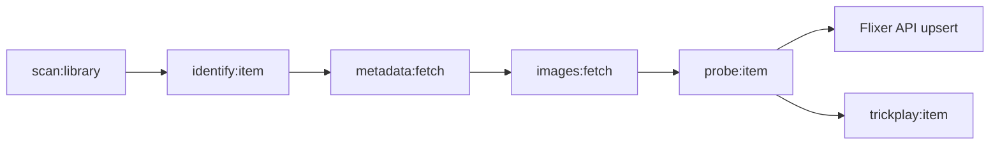

<div align="center">


# Flixer Indexer

**From media files to a beautifully organised library.**

[](https://github.com/flixermedia/flixer-indexer/stargazers) [](https://github.com/flixermedia/flixer-indexer/issues)

[Flixer](https://github.com/flixermedia/flixer) · [Documentation](https://github.com/flixermedia/flixer-docs) · [Report an issue](https://github.com/flixermedia/flixer-indexer/issues)

</div>

---

> [!WARNING]
> **Under active development.** Flixer components and integration contracts may change. Check current source and release notes before upgrading production installations.

> [!NOTE]
> **Role in Flixer:** The Go worker and API service for discovering, identifying, probing, and enriching media. For an end-to-end deployment, start with the [Flixer backend repository](https://github.com/flixermedia/flixer).

## ✨ Features

- **Staged ingestion:** Scan, identify, fetch metadata/images, probe and upsert items.
- **Queue-backed jobs:** Dedicated Redis/Asynq worker pools with adjustable concurrency.
- **Metadata sources:** TMDB, TVDB, OMDb, Fanart.tv, AniList, MusicBrainz and others.
- **Local-first metadata:** NFO files and accompanying artwork take precedence.
- **Media analysis:** FFmpeg/FFprobe and trickplay thumbnail generation.
- **Incremental updates:** Folder watching, item refresh and periodic rescans.

## 🏗️ Architecture

Flixer separates application logic from its web UI, media indexing, media delivery, update management, plugins and documentation. **Flixer Indexer** owns the following responsibility: the Go worker and API service for discovering, identifying, probing, and enriching media.

For the full platform, the API coordinates services; the browser interacts with the backend and the streamer receives authorised playback requests. Components should be operated as part of the supported Flixer stack unless you are developing or testing them directly.

## 🚀 Getting started

### Run from source

Requires Go, Redis, FFmpeg and FFprobe. Run alongside a compatible Flixer API.

```bash
git clone https://github.com/flixermedia/flixer-indexer.git
cd flixer-indexer
cp .env.example .env
# Set FLIXER_URL, APP_SECRET and REDIS_ADDR
go run ./cmd/flixer-indexer
```

For Docker, use the provided `docker-compose.yml` or the main Flixer stack. The worker needs access to the same media locations as Flixer; write access may be needed if artwork is stored alongside files.

## 🏗️ Processing pipeline



`refresh:item` reprocesses an individual path. Worker stages use Redis/Asynq queues. Local NFO and artwork are preferred to provider results; generated caches can be stored under `CACHE_PATH`.

## ⚙️ Configuration

| Variable | Purpose / default |
| --- | --- |
| `PORT` | HTTP API; `8092`. |
| `ROLE` | `all`, `api` or `worker`; default `all`. |
| `FLIXER_URL` | Backend URL; default `http://localhost:8083`. |
| `APP_SECRET` | Shared HMAC signing secret. |
| `REDIS_ADDR` | Queue Redis; default `localhost:6379`. |
| `CACHE_PATH` | Cache root; default `./cache`. |
| `TRICKPLAY_ENABLED` | Thumbnail jobs; default `true`. |
| `WATCH_FOLDERS` | Folder watching; default `true`. |

Provider credentials are fallback values; settings fetched from Flixer take precedence. See [`.env.example`](.env.example) and [`flixer-indexer-SPEC.md`](flixer-indexer-SPEC.md).

## 🔌 Internal API

| Route | Function |
| --- | --- |
| `POST /internal/scan`, `/internal/refresh` | Queue scans or refreshes. |
| `GET /internal/scans`, `/internal/stats` | Observe progress and metrics. |
| `GET /internal/tasks` | Inspect queued work. |
| `POST /internal/queues/{queue}/pause`, `/resume` | Pause and resume work. |
| `GET, POST /internal/concurrency` | Manage worker counts. |
| `POST /internal/settings/reload` | Refresh settings from Flixer. |

Internal calls use timestamped HMAC signatures. Keep these endpoints off public networks.

## 🧩 Flixer ecosystem

| Repository | Purpose |
| --- | --- |
| [Flixer](https://github.com/flixermedia/flixer) | The self-hosted backend API, authentication, libraries, and administration service. |
| [Flixer Web](https://github.com/flixermedia/flixer-web) | The Vue 3 application that powers browsing, sign-in, discovery, and playback interfaces. |
| [Flixer Streamer](https://github.com/flixermedia/flixer-streamer) | The Go service responsible for authorised media delivery and FFmpeg processing. |
| [Flixer Indexer](https://github.com/flixermedia/flixer-indexer) | The Go worker and API service for discovering, identifying, probing, and enriching media. |
| [Flixer Updater](https://github.com/flixermedia/flixer-updater) | The Go sidecar that orchestrates Docker Compose updates and restores. |
| [Flixer Plugins](https://github.com/flixermedia/flixer-plugins) | The official versioned catalogue of Flixer plugins and plugin schemas. |
| [Flixer Docs](https://github.com/flixermedia/flixer-docs) | The Docusaurus source for Flixer platform documentation. |

## 🤝 Contributing

Contributions, bug reports and documentation improvements are welcome. Open an [issue](https://github.com/flixermedia/flixer-indexer/issues) with reproduction steps or a focused proposal, then submit a pull request against the repository. Keep configuration, examples and documentation aligned with implemented code. For backend contributions, also see the [main contribution guidelines](https://github.com/flixermedia/flixer/blob/main/CONTRIBUTING.md).

## 📄 Licence

Check this repository's [`LICENSE`](LICENSE) file, if present, for the authoritative licensing terms. The [main Flixer backend](https://github.com/flixermedia/flixer/blob/main/LICENSE) uses MIT; licensing for separate components should be verified individually before redistribution.

---

<div align="center">

**Your media. Your server. Your rules.**

Made for the [Flixer](https://github.com/flixermedia) ecosystem.

</div>
